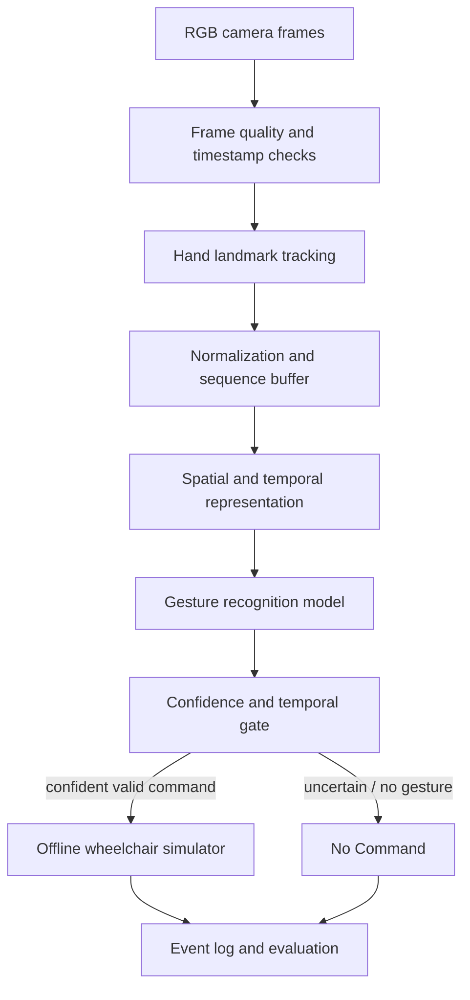

# System Architecture

## Logical pipeline

## Module responsibilities

| Module | Responsibility |
|---|---|
| Capture | Timestamped RGB frame acquisition |
| Tracking | Hand landmark estimation and tracking diagnostics |
| Preprocessing | Coordinate normalization and sequence construction |
| Recognition | Baseline and temporal model inference |
| Gate | Confidence, persistence, timeout, and reject logic |
| Simulator | Offline command visualization; no physical actuation |
| Evaluation | Event metrics, latency, logs, and reproducible reports |

## Safety boundaries

This architecture is a research proposal. The simulator is the only intended actuator in the current phase. A future physical interface would require an independent emergency-stop path, watchdog, speed limits, hardware interlocks, risk analysis, and supervised validation.
